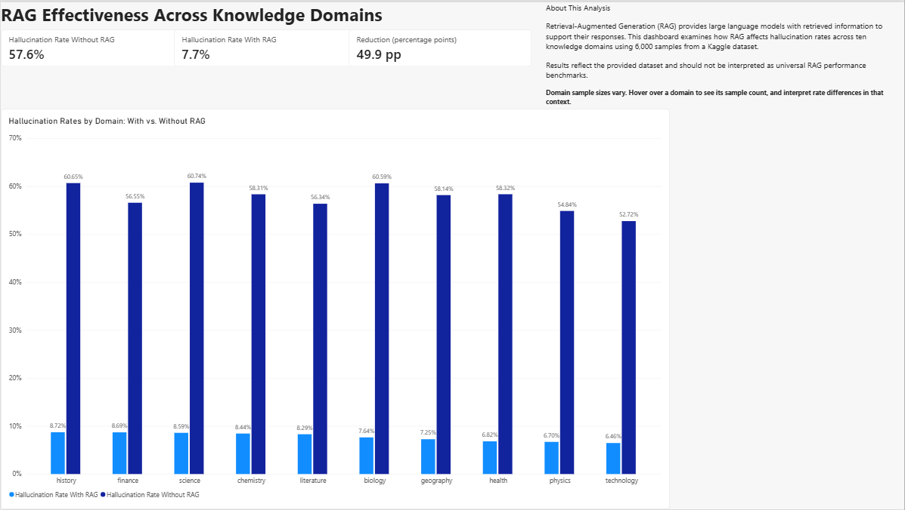
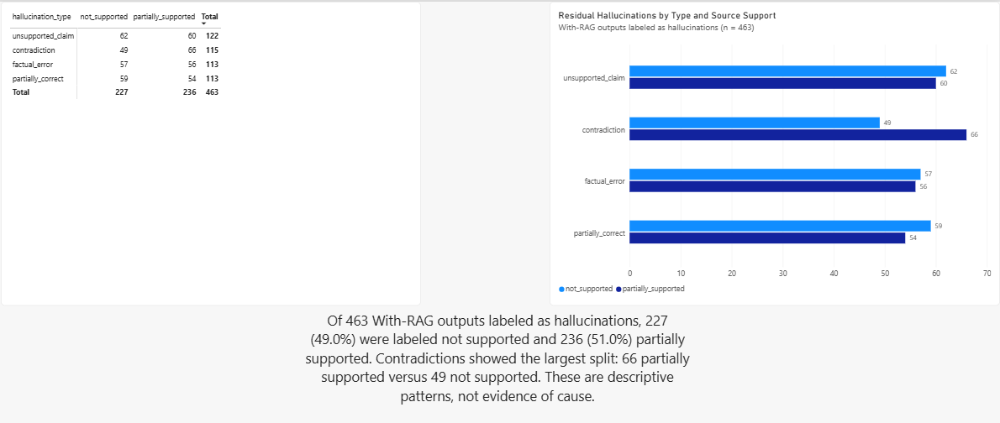

# RAG Hallucination Analysis

A two-page Power BI analysis of hallucination labels in a Kaggle RAG evaluation dataset. The report compares outputs with and without retrieval-augmented generation (RAG), then examines the types and source-support labels of the outputs still marked as hallucinations with RAG.

## Dashboard preview

**RAG effectiveness across knowledge domains**

**Residual hallucinations by type and source support**

[Open the two-page static preview PDF](assets/rag-analysis-preview.pdf) · [Download the Power BI report](powerbi/RAG_Hallucination_Analysis.pbix) · [Read the data dictionary](DATA_DICTIONARY.md)

The screenshots and PDF are static previews. Open the PBIX in Power BI Desktop to explore the interactive report and hover over a domain to see its sample count.

## Headline results

The dataset contains 6,000 samples. Across those samples, the report shows:

| Measure | Result |
| --- | ---: |
| Hallucination rate without RAG | 57.6% |
| Hallucination rate with RAG | 7.7% |
| Difference | 49.9 percentage points |

The difference is calculated as the rate without RAG minus the rate with RAG. The 49.9 figure is a percentage-point difference, not a relative percent decrease.

Rates vary across domains. In this dataset, History has the highest with-RAG rate (8.72%), while Technology has the lowest (6.46%). Biology shows the largest with-versus-without rate difference. Domain sample sizes vary: History has 803 samples and Biology has 406, so rate comparisons should be read alongside the counts.

## What remains after RAG

The second page filters to the 463 samples labeled as hallucinations with RAG and breaks them down by hallucination type and source-support label.

| Hallucination type | Not supported | Partially supported | Total |
| --- | ---: | ---: | ---: |
| unsupported_claim | 62 | 60 | 122 |
| contradiction | 49 | 66 | 115 |
| factual_error | 57 | 56 | 113 |
| partially_correct | 59 | 54 | 113 |
| **Total** | **227** | **236** | **463** |

Of the 463 residual outputs, 227 (49.0%) were labeled not supported and 236 (51.0%) partially supported. Contradictions have the largest gap between the two source-support labels: 66 partially supported and 49 not supported.

## Project files

- **Power BI:** `powerbi/RAG_Hallucination_Analysis.pbix`
- **Static previews:** `assets/`
- **Data source and field notes:** `DATA_DICTIONARY.md`

## Source

[Hallucination Reduction in RAG-Based LLMs — Kaggle](https://www.kaggle.com/datasets/sohaibdevv/hallucination-reduction-in-rag-based-llms)

## Interpretation

These are descriptive results for this dataset and its labels. They are not a universal benchmark for RAG systems and do not establish that RAG alone caused the observed differences. Domain sample sizes are unequal; use the report's sample-count tooltip when comparing domain rates.
